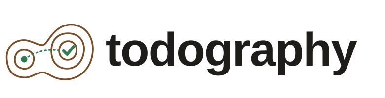

  
  

# Introduction

todography keeps a map of a software project in the project's own
repository. The map says what the project is made of, how the pieces depend
on each other, and how far along each piece is.

The map is plain files. Each component is one Markdown file under
`docs/map/`, with a few lines of TOML at the top. You edit those files
next to the code they describe, in the same commits, and review them in the
same pull requests. Coding agents can edit them too.

From those files, `todography` works out the rest:

- **Status.** A component is done, partly done, in progress or still to do,
  depending on its features.
- **Wanted.** You mark the components you want for their own sake as goals.
  Everything a goal needs is wanted too, through any number of steps.
- **Why.** For each piece that isn't a goal, the chains of needs that lead
  down to it from a goal. That answers "why is this here?"
- **Ready and blocked.** Unfinished work whose dependencies are done is
  ready. The rest is blocked, and the map says by what.
- **Research debt.** Wanted pieces whose own dependencies nobody has looked
  into yet.

You can ask about the map from the command line, open it as an interactive
page in a browser, or browse it in the terminal.

## Why a map

Issue trackers are good at handing out tasks. They are bad at showing where
a project stands as a whole: which areas are solid, which are thin, what
you would have to build before the thing you actually want. A map shows
that at a glance, and because it lives in the repository, it changes when
the code changes.

The name is *todo* and *topography* run together: a map of the terrain
between you and done. Labels use the scheme `t8y:`, a numeronym of the
name, so `t8y:/exec/mailboxes` names a component and
`t8y:/exec/mailboxes#basic` one of its features.

## Where to go from here

- [Getting started](getting-started.md) installs the tool and makes a
  small map with two components.
- [The walkthrough](walkthrough/index.md) explains every idea using
  todography's own map, which lives in the repository as an example. You
  can [open that map's page](example/index.html) right now.
- [The reference](reference/format.md) covers every field, rule, command
  and key.
